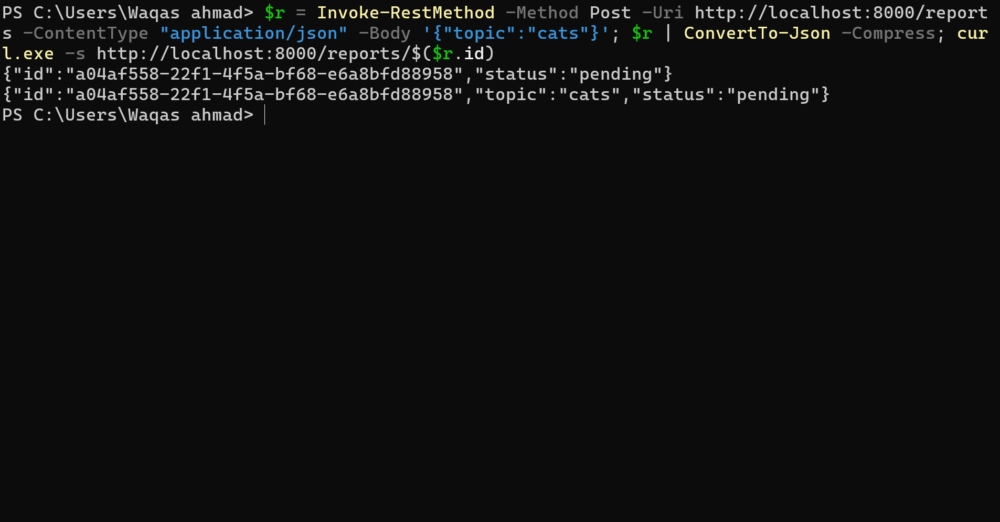

# Background Job API — FastAPI + Inngest

A background job API built with **FastAPI** and **Inngest** for the FlyRank Internship, Assignment A7: *Your First Background Job*.

The API accepts a request, answers immediately, and does the slow work in the background. Clients check progress with a report ID.

## How It Works

When a client submits a report request:

1. The API validates the request. Invalid input is rejected with `400 Bad Request` and nothing is queued.
2. A report is created with a unique ID and the status `pending`.
3. The API immediately returns `202 Accepted`.
4. A `report/requested` event is sent to Inngest.
5. Inngest runs the `make-report` function in the background, retrying on failure.
6. The report status becomes `done` or `failed`.

## Technologies

| Technology | Purpose |
|---|---|
| Python | Main language |
| FastAPI | REST API framework |
| Inngest | Background job orchestration |
| Uvicorn | ASGI server |
| Inngest Dev Server | Local monitoring dashboard |
| Git and GitHub | Version control and hosting |

## Project Structure

```text
background-job-api/
├── main.py
├── requirements.txt
├── README.md
├── START_HERE.txt
├── test_requests.bat
├── .gitignore
└── screenshots/
    ├── stage-1-say-hello.png
    ├── stage-2-http-202.png
    ├── stage-2-report-pending.png
    ├── stage-2-report-done.png
    ├── stage-3-failed-run.png
    ├── stage-3-report-failed.png
    ├── stage-3-retries-confirmed.png
    ├── stage-3-validation-400.png
    └── stage-4-heartbeat.png
```

## Getting Started

### Prerequisites

- Python 3.10 or newer
- Node.js and npm (the Inngest Dev Server runs through `npx`)
- Git

### 1. Clone the repository

```bash
git clone https://github.com/Waqas392/background-job-api.git
cd background-job-api
```

### 2. Create and activate a virtual environment

Windows:

```bash
python -m venv .venv
.venv\Scripts\activate
```

macOS / Linux:

```bash
python3 -m venv .venv
source .venv/bin/activate
```

### 3. Install dependencies

```bash
python -m pip install --upgrade pip
pip install -r requirements.txt
```

## Running the Application

You need two terminal windows, and both must stay running.

**Terminal 1 — FastAPI server** (start this first)

```bash
uvicorn main:app --reload --port 8000
```

API: `http://localhost:8000`

**Terminal 2 — Inngest Dev Server**

```bash
npx inngest-cli@latest dev -u http://localhost:8000/api/inngest
```

Dashboard: `http://localhost:8288`

Use the dashboard to watch events, function runs, retries, and scheduled jobs.

## API Endpoints

| Method | Endpoint | Description |
|---|---|---|
| GET | `/health` | Check API health |
| POST | `/reports` | Create a background report |
| GET | `/reports/{report_id}` | Get a report by ID |
| GET | `/reports` | List reports |

## Inngest Functions

| Function | Trigger | Description |
|---|---|---|
| `say-hello` | `test/hello` event | Simple background task with a 5-second delay |
| `make-report` | `report/requested` event | Generates a report with an 8-second delay, with 2 retries |
| `heartbeat` | Cron, every minute | Logs the number of pending, done, and failed reports |

---

## Implementation Stages

### Stage 0 — Hello Server

A FastAPI app with a health-check endpoint.

```http
GET /health
```

```json
{ "status": "ok" }
```

### Stage 1 — Inngest Integration

Inngest is connected to FastAPI with the client ID `report-api`. The `say-hello` function is triggered by the `test/hello` event and waits five seconds before completing.


### Stage 2 — Background Report Processing

`POST /reports` creates a report and returns right away, so the client never waits for the slow work.

Request (Windows Command Prompt):

```bash
curl -i -X POST http://localhost:8000/reports -H "Content-Type: application/json" -d "{\"topic\":\"cats\"}"
```

Response:

```http
HTTP/1.1 202 Accepted
```

```json
{
  "id": "ebb1af58-3f02-40ed-b477-49b0b7289f82",
  "status": "pending"
}
```


Polling right after the POST, while the job is still running, shows the report as `pending`. This PowerShell command submits a fresh report and polls it immediately:

```powershell
$r = Invoke-RestMethod -Method Post -Uri http://localhost:8000/reports -ContentType "application/json" -Body '{"topic":"cats"}'; $r | ConvertTo-Json -Compress; curl.exe -s http://localhost:8000/reports/$($r.id)
```

The first line printed is the `202` body with the new report's ID, and the GET result below it shows `"status":"pending"`.



After the background job finishes (about 8 seconds), polling the first report's ID returns the completed result:

```bash
curl http://localhost:8000/reports/ebb1af58-3f02-40ed-b477-49b0b7289f82
```

```json
{
  "id": "ebb1af58-3f02-40ed-b477-49b0b7289f82",
  "topic": "cats",
  "status": "done",
  "result": "Report about cats: this is a sample generated report."
}
```


### Stage 3 — Retries and Input Validation

**Retries.** `make-report` is configured with 2 retries, so a failing job runs up to **3 times in total** (Attempt 0, Attempt 1, Attempt 2). If every attempt fails, Inngest marks the run as failed and the report status becomes `failed`.

To test this, submit the topic `fail`:

```bash
curl -i -X POST http://localhost:8000/reports -H "Content-Type: application/json" -d "{\"topic\":\"fail\"}"
```

In the Inngest dashboard, the failed `make-report` run shows the `build-report` step with a "2 retries" badge. Attempts 0, 1, and 2 all end with the error `The report oven is broken!`, and the gaps between attempts grow because Inngest backs off between retries.


Checking the report afterwards shows `"status":"failed"`:


**Input validation.** Requests with missing or invalid input are rejected with `400 Bad Request` before any event is sent to Inngest, so no background job is queued.


**Retries vs. validation.** Retries handle failures that happen while the job is running, such as a temporary error that may succeed on the next attempt. Validation rejects bad input up front. Retrying an invalid request would never fix it, so it is never queued.

### Stage 4 — Scheduled Cron Job

The `heartbeat` function runs on an Inngest cron schedule:

```text
* * * * *
```

This runs it every minute. Each run logs the number of pending, done, and failed reports. The dashboard shows a new completed `heartbeat` run every minute with different timestamps.


Other cron examples:

| Cron Expression | Schedule |
|---|---|
| `* * * * *` | Every minute |
| `0 8 * * *` | Every day at 08:00 |
| `0 22 * * 0` | Every Sunday at 22:00 |

---

## Report Statuses

| Status | Meaning |
|---|---|
| `pending` | Accepted and queued, not finished yet |
| `done` | The background job completed successfully |
| `failed` | The job failed after all retry attempts |

## Troubleshooting

- **No functions show up in the Inngest dashboard.** Make sure the FastAPI server is running on port 8000 before starting the Dev Server, and that the `-u` URL ends with `/api/inngest`.
- **Reports stay `pending`.** Check that the Inngest Dev Server terminal is running and that the `report/requested` event appears under Events in the dashboard.
- **Reports disappear after a restart.** This is expected, because reports are stored in memory (see below).

## Limitations

Reports are stored in memory, so they are lost when the application restarts. A real deployment would use a database.

## What This Project Demonstrates

- Building a background job API with FastAPI
- Integrating Inngest into a Python app
- Returning `202 Accepted` and processing work asynchronously
- Tracking job status by ID
- Automatic retries on failure
- Validating requests before queuing work
- Scheduling recurring cron jobs
- Monitoring runs in the Inngest Dev Server

## Author

**Waqas Ahmad**

- GitHub: [@Waqas392](https://github.com/Waqas392)
- Repository: [background-job-api](https://github.com/Waqas392/background-job-api)
- Program: FlyRank Internship
- Assignment: A7 — Your First Background Job