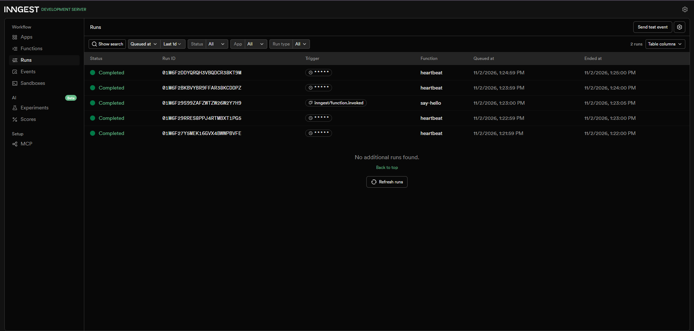
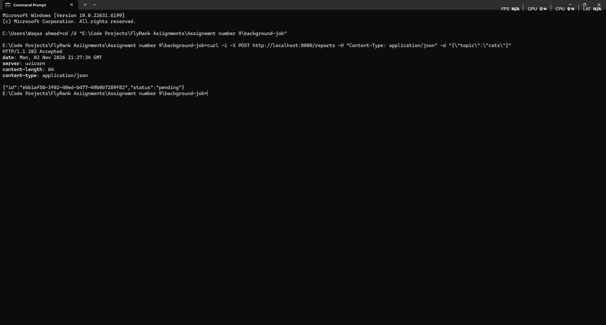
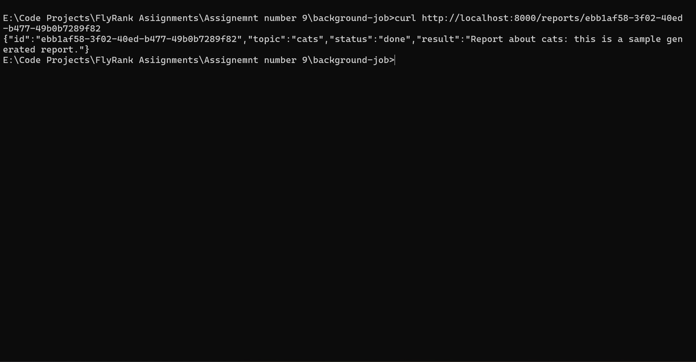
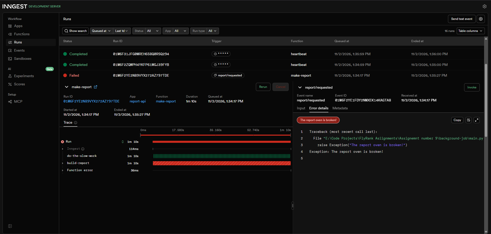
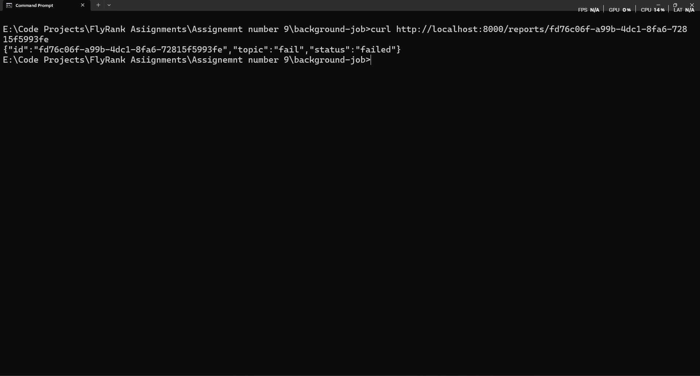
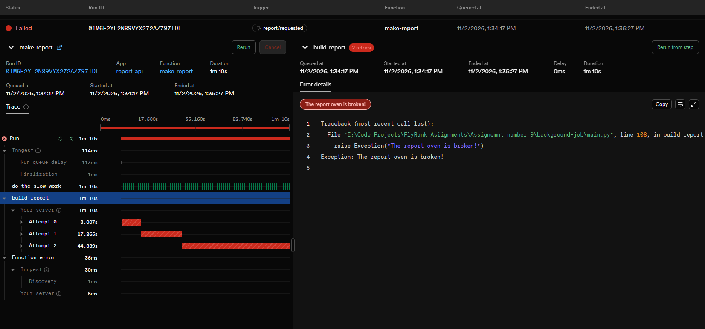
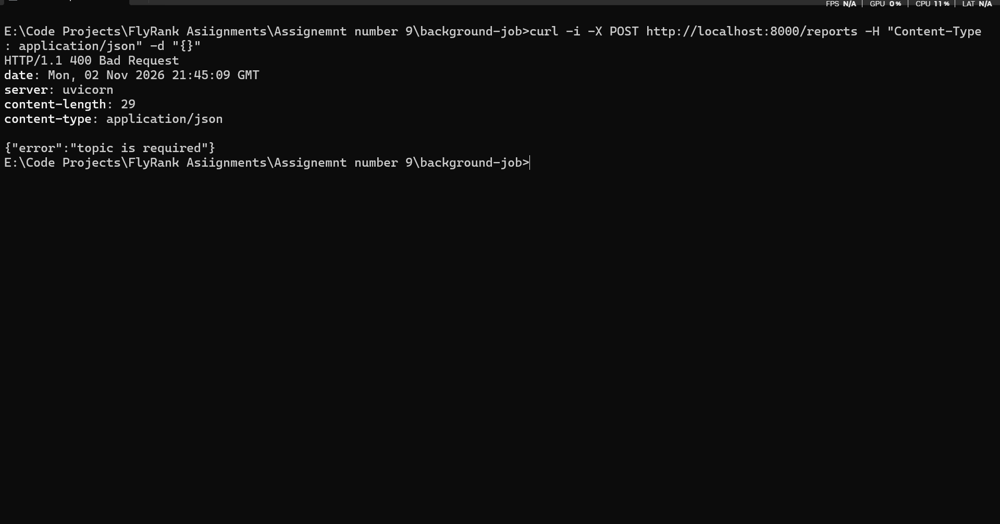
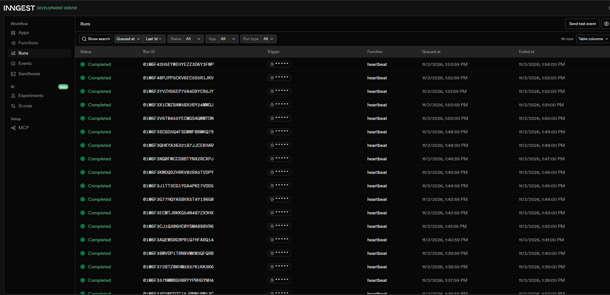

# Background Job API — FastAPI + Inngest

A background job processing API built with **FastAPI** and **Inngest** for FlyRank Internship Assignment A7 — *Your First Background Job*.

This project demonstrates how to accept an API request immediately, process time-consuming work asynchronously in the background, and allow clients to track the job's progress.

## Project Overview

When a client submits a report request:

1. The API validates the incoming request.
2. A report is created with a unique ID.
3. The API immediately returns `202 Accepted`.
4. An event is sent to Inngest.
5. Inngest processes the report in the background.
6. The report status is updated to `done` or `failed`.

The project also demonstrates automatic retries, input validation, and scheduled cron jobs.

## Technologies Used

| Technology | Purpose |
|---|---|
| Python | Main programming language |
| FastAPI | REST API framework |
| Inngest | Background job orchestration |
| Uvicorn | ASGI server |
| Inngest Dev Server | Local workflow monitoring |
| Git and GitHub | Version control and hosting |

## Project Structure

```text
background-job/
│
├── main.py
├── requirements.txt
├── README.md
├── START_HERE.txt
├── test_requests.bat
├── .gitignore
│
└── screenshots/
    ├── stage-1-say-hello.png
    ├── stage-2-http-202.png
    ├── stage-2-report-done.png
    ├── stage-3-failed-run.png
    ├── stage-3-report-failed.png
    ├── stage-3-retries-confirmed.png
    ├── stage-3-validation-400.png
    └── stage-4-heartbeat.png
```

## Getting Started

### Prerequisites

- Python 3.10 or newer
- Node.js and npm
- Git

### 1. Clone the repository

```bash
git clone https://github.com/Waqas392/background-job-api.git
cd background-job-api
```

### 2. Create a virtual environment

```bash
python -m venv .venv
.venv\Scripts\activate
```

### 3. Install dependencies

```bash
python -m pip install --upgrade pip
pip install -r requirements.txt
```

## Running the Application

The application requires two terminal windows.

### Terminal 1 — FastAPI server

```bash
uvicorn main:app --reload --port 8000
```

API address:

`http://localhost:8000`

### Terminal 2 — Inngest Dev Server

```bash
npx inngest-cli@latest dev -u http://localhost:8000/api/inngest
```

Inngest dashboard:

`http://localhost:8288`

The dashboard allows you to monitor events, function executions, retries, and scheduled jobs.

## API Endpoints

| Method | Endpoint | Description |
|---|---|---|
| GET | `/health` | Check API health |
| POST | `/reports` | Create a background report |
| GET | `/reports/{report_id}` | Retrieve a report by ID |
| GET | `/reports` | List available reports |

## Inngest Functions

The application contains three background functions.

| Function | Trigger | Description |
|---|---|---|
| `say-hello` | `test/hello` | Executes a simple background task with a 5-second delay |
| `make-report` | `report/requested` | Generates a report asynchronously with an 8-second delay |
| `heartbeat` | Cron schedule | Periodically checks report counts |

---

## Implementation Stages

### Stage 0 — Hello Server

Created the FastAPI application and health-check endpoint.

**Endpoint:**

```http
GET /health
```

**Expected response:**

```json
{
  "status": "ok"
}
```

### Stage 1 — Inngest Integration

Integrated Inngest with FastAPI using the client ID `report-api`.

Created the `say-hello` function, triggered by the `test/hello` event. The function waits five seconds before completing.

**Execution evidence:**



### Stage 2 — Background Report Processing

Implemented asynchronous report creation using the `POST /reports` endpoint.

**Request:**

```http
POST /reports
Content-Type: application/json
```

```json
{
  "topic": "cats"
}
```

The API immediately returns HTTP `202 Accepted`, allowing the background job to run without making the client wait.

**Actual POST response:**

```http
HTTP/1.1 202 Accepted
```

```json
{
  "id": "ebb1af58-3f02-40ed-b477-49b0b7289f82",
  "status": "pending"
}
```

**POST request evidence:**



The report can be checked using its unique ID.

**Status endpoint:**

```http
GET /reports/ebb1af58-3f02-40ed-b477-49b0b7289f82
```

**Actual completed report response:**

```json
{
  "id": "ebb1af58-3f02-40ed-b477-49b0b7289f82",
  "topic": "cats",
  "status": "done",
  "result": "Report about cats: this is a sample generated report."
}
```

**Completed report evidence:**



### Stage 3 — Retries and Input Validation

Implemented error handling, automatic retries, and request validation.

**Retry handling**

The `make-report` function is configured with two retries.

When a report is submitted with the topic `fail`, the function raises an error during processing. Inngest retries the execution and eventually marks it as failed after the configured attempts.

**Input validation**

Requests with missing or invalid required input are rejected with HTTP `400 Bad Request`.

Invalid requests are rejected before a background job is queued.

**Retries vs. validation**

Retries handle failures that happen during background processing. Validation rejects incorrect input before processing begins. Retrying an invalid request would not fix the problem.

**Execution evidence:**









### Stage 4 — Scheduled Cron Job

Implemented a scheduled `heartbeat` function using Inngest cron.

**Cron expression:**

```text
* * * * *
```

This schedules the function to run every minute.

The function periodically checks and logs report counts:

- Pending reports
- Completed reports
- Failed reports

**Heartbeat execution evidence:**



#### Additional Cron Examples

| Cron Expression | Schedule |
|---|---|
| `* * * * *` | Every minute |
| `0 8 * * *` | Every day at 08:00 |
| `0 22 * * 0` | Every Sunday at 22:00 |

---

## Important Implementation Details

### Asynchronous Processing

The API returns `202 Accepted` without waiting for report generation to finish. Inngest handles the background execution.

### Report Status Tracking

Reports use three processing statuses:

- `pending`
- `done`
- `failed`

Clients can retrieve report information using its unique ID.

### Error Handling

Inngest handles configured retries when a background function encounters an error.

### Storage

The current implementation uses in-memory report storage. Report records are therefore not persistent across application restarts.

## What This Project Demonstrates

- Building background job APIs with FastAPI.
- Integrating Inngest into a Python application.
- Returning HTTP `202 Accepted`.
- Processing events asynchronously.
- Tracking background job status.
- Handling function failures and retries.
- Validating incoming requests.
- Scheduling recurring cron jobs.
- Monitoring background executions through the Inngest Dev Server.

## Author

**Waqas Ahmad**

- GitHub: [@Waqas392](https://github.com/Waqas392)
- Repository: [background-job-api](https://github.com/Waqas392/background-job-api)
- Program: FlyRank Internship
- Assignment: A7 — Your First Background Job
